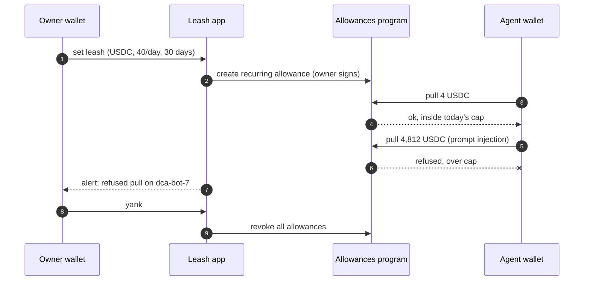

# Leashonsol
<h1 align="center">Leash</h1>

<p align="center">
  <b>Spending limits for AI agents on Solana.</b><br/>
  Let your agent spend. Keep the leash.
</p>

<p align="center">
  
  
  
  
  <a href="https://x.com/leashonsol"></a>
</p>

> Leash is an independent project. It is not affiliated with, endorsed by or sponsored by the Solana Foundation.

---

## 🐕 Why Leash

AI agents now trade, pay for data and run errands on Solana. To do it, most of them get a private key and the whole balance behind it.

That works until it doesn't. One poisoned prompt, one bad tool call or one compromised plugin, and the wallet empties in a single transaction. Solana is fast and final. **There is no undo.**

An agent with a hot wallet is a dog off the leash.

**Leash gives your agent a budget instead of your keys.**

## 🦴 How it works

Leash is built on [Solana Subscriptions & Allowances](https://solana.com/news/subscriptions-and-allowances), the shared on-chain program for capped and recurring spending. Your tokens stay in your wallet. The agent only gets a capped, expiring permission to pull from it.

1. **Clip.** Pick an agent wallet and set its leash: token, cap per day or week, end date and an optional max per pull. Leash writes it as a native allowance. One signature.
2. **Walk.** The agent pays for swaps, data and tools on its own, inside the cap. The program checks every pull on-chain. Leash shows each one live and alerts you at 50, 80 and 100 percent.
3. **Yank.** Something looks off? One tap revokes every allowance you gave, across every agent. Nothing to claw back, because the money never left.



## 🪢 What a leash controls

| Rule | Example | Enforced by |
|---|---|---|
| `token` | `USDC` | Allowances program |
| `cap` per period | `40 USDC / day` | Allowances program. Resets every period. |
| `ends` | `30d` | Allowances program. The allowance expires on its own. |
| `perPull` | `10 USDC` | Leash SDK and MCP server, before a pull is sent |
| `alerts` | `50 / 80 / 100%`, new destination | Leash watcher |
| `revoke` | one tap, all agents | Owner signs the revoke. Leash batches it. |

The on-chain cap is the hard ceiling. Even an agent that ignores the SDK can never pull more than its allowance.

## ⚡ Quickstart (SDK preview)

> Packages are not published yet. Names and APIs may change before release.

**Agent: ask for a budget, not a key**

```ts
import { Leash } from "@leash/sdk";

const leash = new Leash({ cluster: "mainnet-beta" });

const req = await leash.request({
  agent: wallet.publicKey,
  token: "USDC",
  perDay: 40,
  perPull: 10,
  ends: "30d",
  reason: "DCA into SOL + price data",
});

await req.approved();                         // owner taps approve
await leash.pull({ amount: 4, to: JUP_FEES });
// over the cap? the program refuses it.
```

**Agent via MCP**

```json
{
  "mcpServers": {
    "leash": {
      "command": "npx",
      "args": ["-y", "@leash/mcp"]
    }
  }
}
```

Tools exposed to the agent:

| Tool | What it does |
|---|---|
| `leash_status` | Budget left today and when the leash ends |
| `leash_request` | Ask the owner for a new or bigger leash, with a reason |
| `leash_pull` | Pay inside the cap |

## 🏗️ Architecture

| Component | What it does |
|---|---|
| `app/` | Owner dashboard: clip, watch and yank leashes from web or phone |
| `sdk/` | TypeScript SDK for agents: request, check and pull from a leash |
| `mcp/` | MCP server so any MCP-capable agent can see and use its budget |
| `watcher/` | Indexes allowance activity and sends alerts (Telegram, email, webhook) |
| `baddog/` | Staked registry of drainer addresses that agents are warned and blocked from paying |

Leash never holds user funds or keys. Allowances live in the Solana Subscriptions & Allowances program and work with SPL Token and Token-2022.

## 🪙 $LEASH

Your funds never depend on a token. Allowances work in USDC, SOL or any SPL token. $LEASH runs the tools around them.

| Role | How it works |
|---|---|
| **Pro by holding** | Hold $LEASH to unlock Pro: more agents, Telegram approvals, team wallets, faster alerts. |
| **Bad Dog list** | Stake to flag drainer addresses. Correct flags earn, false flags get slashed. |
| **Buybacks** | A share of Pro revenue buys $LEASH from the market. |
| **Safe defaults by vote** | Holders vote on the presets every new leash starts with: default caps, end dates, alert levels. |

**Contract address:** announced only on [@leashonsol](https://x.com/leashonsol). Never trust a CA from DMs.

## 🗺️ Roadmap

- [ ] **Phase 1 · Leash**: $LEASH launch on Solana, dashboard (clip, watch, yank), per-period caps and expiry, pull alerts
- [ ] **Phase 2 · Pack**: leash requests from agents, SDK and MCP server, Telegram approvals, team wallets
- [ ] **Phase 3 · Bad Dog**: staked drainer blocklist, Pro tier by holding, alerts on new destinations
- [ ] **Phase 4 · Kennel**: holder votes on safe defaults, buybacks from Pro revenue, plug-ins for agent frameworks

## ❓ FAQ

<details>
<summary><b>Does Leash hold my money?</b></summary>
No. Your tokens stay in your wallet. The agent gets an allowance, a permission to pull up to a cap, checked by the Solana Subscriptions & Allowances program. Leash is the dashboard, SDK and alert layer on top.
</details>

<details>
<summary><b>What happens if my agent gets prompt-injected?</b></summary>
It can still only pull what its allowance allows. A request for 4,800 USDC on a 40 USDC daily leash is refused on-chain. You get an alert and can revoke every allowance in one tap.
</details>

<details>
<summary><b>Does my agent still need a private key?</b></summary>
It needs its own wallet to sign as the delegate. It never needs yours. Keep the agent wallet nearly empty and let it spend from the allowance.
</details>

<details>
<summary><b>Is the per-pull limit enforced on-chain?</b></summary>
The cap per period and the end date are enforced on-chain by the Allowances program. The per-pull limit is enforced by the Leash SDK and MCP server before a pull is sent. Set the period cap to the most you are willing to lose in one period.
</details>

<details>
<summary><b>Which tokens work?</b></summary>
Any token on SPL Token or Token-2022, including USDC. $LEASH is only needed for Pro features and the Bad Dog list, never for the allowances themselves.
</details>

<details>
<summary><b>Is it audited?</b></summary>
The Subscriptions & Allowances program is a shared Solana program that has been audited. Leash's own code is open source here, and audits will be published in this repo as they happen.
</details>

## 🔗 Links

- **X:** [@leashonsol](https://x.com/leashonsol)
- **Website:** [YOUR DOMAIN]
- **Solana Subscriptions & Allowances:** [solana.com/news/subscriptions-and-allowances](https://solana.com/news/subscriptions-and-allowances)

## 🤝 Contributing

Leash is pre-alpha. Issues and ideas are welcome. Open an issue before starting a large change so we walk in the same direction.

## 📄 License

[YOUR LICENSE]

<p align="center"><sub>Good agents stay on the leash. 🐕</sub></p>
